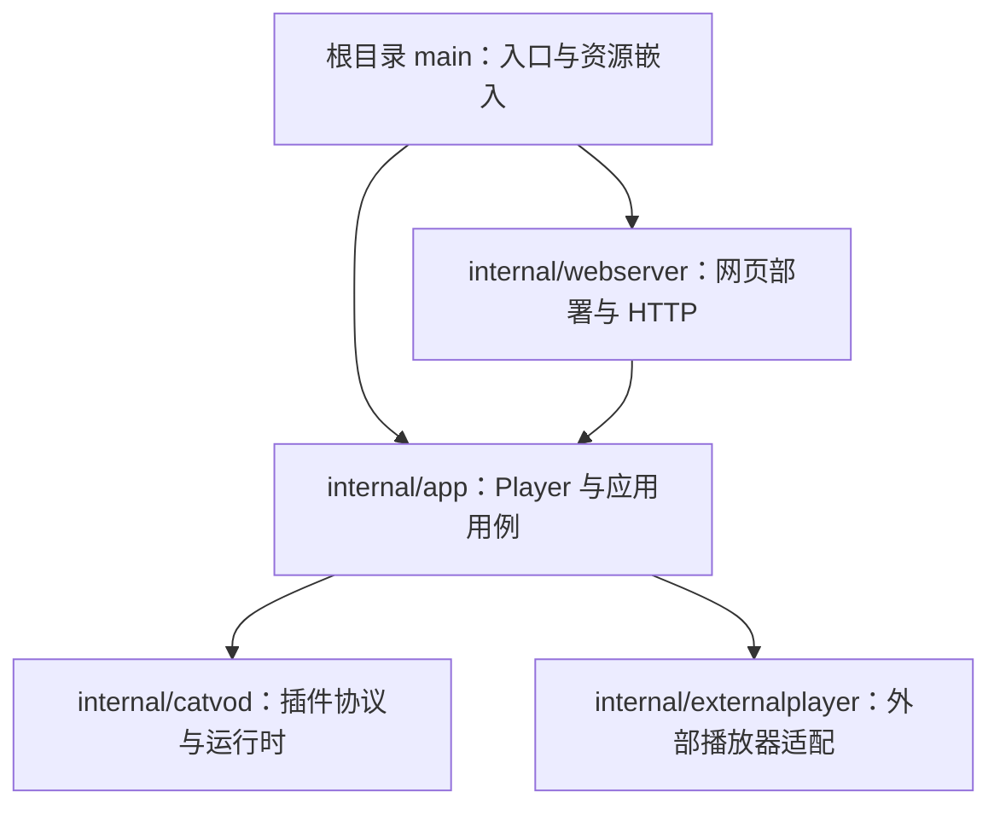

# Go 代码结构

本项目是一个 Go 模块、一个可执行程序，提供 MyGo 桌面模式和 HTTP 网页模式。根目录保留构建入口，内部实现放入 `internal/`；前端仍使用无需构建的原生脚本。



## 包职责

- `app` 持有 Player 状态、锁和生命周期，协调设置、订阅、插件加载、浏览、搜索、播放、历史及日志。文件按用例划分；需要同一状态和锁的流程留在这个包中。
- `webserver` 负责网页模式环境配置、认证、RPC、流式响应、海报和媒体转发。RPC 方法白名单保持显式声明。
- `externalplayer` 负责本机播放器发现、启动参数与平台命令适配。保存设置、用户对话框调用和播放用例由 `app` 协调。
- `catvod` 负责源下载、Node 插件宿主、协议客户端、媒体代理和可选播放桥。

依赖沿图中方向流动。应用层不导入网页服务器；不要创建用于收纳无关函数的 `utils` 或 `common` 包。

## 入口、资源与兼容契约

`main.go` 嵌入 `web/` 和 `webassets/`。通过 `fs.FS` 向应用与网页服务器提供资源，包内部不依赖进程工作目录。测试使用同一资源目录。

`app.New` 创建运行时对象。桌面模式将其 `Player` 交给 MyGo 绑定；网页模式通过相同的 Player 执行用例。运行时对象承载网页适配所需的搜索与代理访问，避免给前端 Player 绑定增加部署方法。

重构保留 `Player.*` 方法、JSON 字段、HTTP 路径与响应、用户数据位置和平台行为。`mygo.ts` 由 `go tool mygo generate` 生成。新增用户能力时应明确维护这些契约。

## 测试与构建

Go 测试与其所属包放在一起；协议 mock 插件位于 `internal/catvod/testdata/`。前端与构建脚本测试沿用原位置。

```sh
go vet ./...
go test ./...
go test -race ./...
node --test web/*.test.cjs
bash scripts/build.test.sh
```

发布构建继续由根目录 `mygo.json` 和现有脚本驱动，三平台验证由 CI 的构建矩阵执行。

## 参考

- [Go 官方模块布局指南](https://go.dev/doc/modules/layout)：命令项目可在根目录保留入口，支持实现放入 `internal/`。
- [Go 包命名建议](https://go.dev/blog/package-names)：包围绕明确职责组织，避免泛化命名。
- [MyGo 配置](https://mygo.egoist.dev/docs/configuration)：`main` 默认指向项目根目录。
